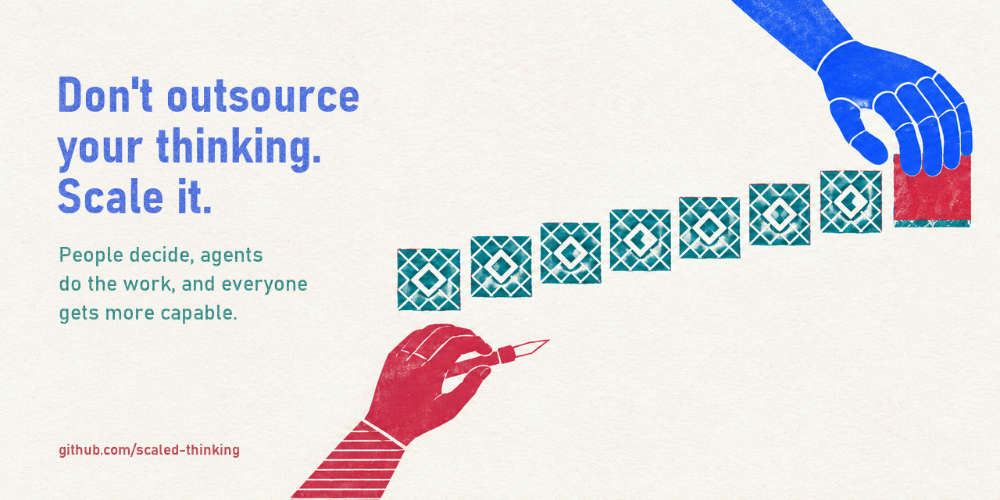
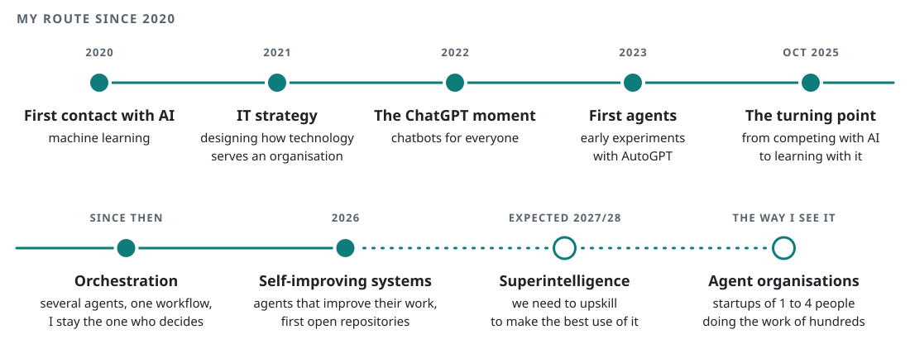

<picture>
  <source media="(prefers-color-scheme: dark)" srcset="docs/assets/journey-dark.svg">
  
</picture>

## The moment work changed

In October 2025 I hit a technical problem on a platform I am responsible for, one that would
normally have needed the vendor's support. I wrote a precise prompt, added the full context in
machine-readable form, and got back a flawless twenty-step guide. Three months earlier that had not
been possible, and coding agents had just become usable for the first time.

That was when I saw that work would change completely, and that this was the weakest AI I would ever
work with. After two weeks of taking that in, I committed fully to upskilling.

## How I keep learning

In agentic AI, new knowledge has a half-life of about three months, so I rebuild my stack about that
often. I treat my own learning like an innovation process: try early, keep what proves itself, drop
what has turned into an anti-pattern. That is why I build vendor-agnostic and modular.

## What stays with people

Some tasks no longer need people, and fighting that change helps no one. Many of my projects run
fully automated: agents do the work end to end, with clear governance and observability, ideally
without anyone having to step in.

Soon AI may do almost any task better than any of us, so the case for people cannot rest on being
better. It rests on what is ours: deciding what is worth doing and for whom, bringing the human
context, and answering for the outcome.

Owning that takes competence. So I automate the work and build up the people who direct it. The time
and money this frees should go into new ideas and into work that fulfils people.

## Why I share

AI is disruptive enough that sharing knowledge and building skills cannot wait. In my experience,
the gap between advanced AI-native users and everyone else keeps growing, and it holds back the
competitiveness and innovation of most people. The transition only works if companies, people and
society make it together.

So I share what proves itself, to help others use AI to create value, ideally like this:

<picture>
  <source media="(prefers-color-scheme: dark)" srcset="docs/assets/competence-dark.svg">
  
</picture>

## What I share

The aim: each repository is a module your personal agent can call. A few exceptions keep the entry
barrier low for people who have never used a coding agent.

- **[present-together](https://github.com/scaled-thinking/present-together)**: get better at explaining
  what you know, with an agent that coaches you on the teaching and builds the presentation.
- **[open-research-loops](https://github.com/scaled-thinking/open-research-loops)**: parallel,
  vendor-agnostic research loops for open science problems, autonomous or coached.
- **An agent-first platform**, in progress: agents build and run products, a meta-agent improves the
  platform from its own logs, and guardrails live in code so people stay in charge.

More follow one by one, as long as they are still current.

## Background

- **Trainer** for innovation venture labs and for innovation processes and management, from a design
  thinking, lean startup and change management perspective.
- **Agentic AI** in private projects since 2023, from first experiments with AutoGPT to fully automated systems.

From infrastructure work I bring one habit: every change needs a plan, a fallback and evidence. My
agents work the same way.

## Get in touch

Ventures, collaborations, talks or questions: qek4g8pbw@mozmail.com
