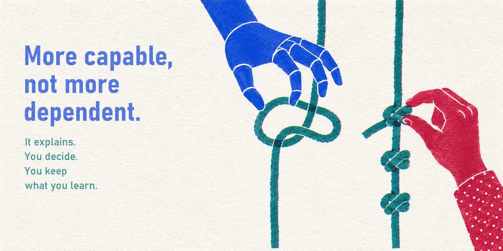
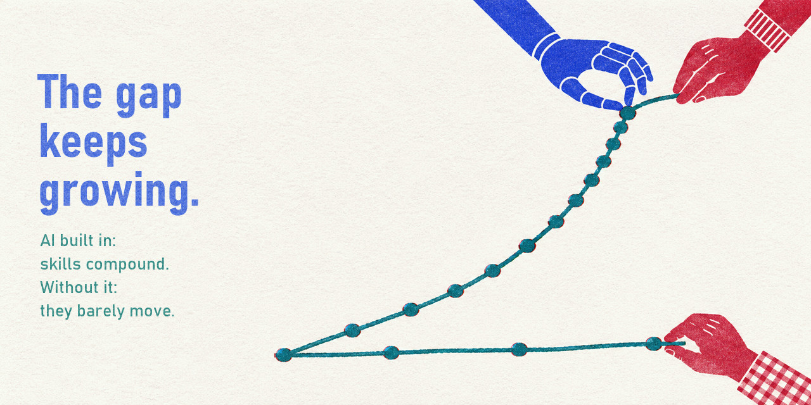

**scaled-thinking is a family of free, open modules for your own AI agent. Each module is a specialist
(an agent, a service or a capability) that extends what you and your agent can do. Take one or
several: most modules run only while they are needed.**

To find yours, copy this prompt into your AI agent. It reads the public repositories here and
suggests modules from what it knows about your work.

```text
Look at https://github.com/scaled-thinking and its public repositories. Based on what you know about
me, my work and my current tasks, pick the modules that would help me most, as many as are useful.
If you know too little about me, ask me three short questions first. Introduce each module in a few
sentences, say why it fits me and whether it is ready to use, then discuss them with me. I decide
what to try; don't install or run anything yet. Reply in my language.
```

Your agent needs web access to read GitHub. Each module is yours to keep: its open licence lets you
use, change and share it, for good. What your agent knows about you stays between you, your AI
provider and the services your agent uses; the modules send nothing to scaled-thinking, and you need
no account with us.

<details>
<summary>Or start right away: prepare a talk with present-together</summary>

[present-together](https://github.com/scaled-thinking/present-together), the first ready module,
coaches you through a talk, lecture or seminar. The coaching works in almost any AI chat.

```text
Use https://github.com/scaled-thinking/present-together as your guide and follow its
SKILL.md. Coach me so I get better at explaining my topic. Handle all the technical work
yourself. Reply in my language.

My talk (fill in what you know): topic, audience, length, what they should take away.
```

1. Paste the prompt into your agent and fill in "My talk".
2. Answer a few questions. The guide tells the agent to check its own tools first and to open your
   material only after you confirm you may use it.
3. Decide what to keep. Say "shorter", "explain more" or "just do it" at any time.

At the end you get a method card for the next talk.
[One talk, start to finish](https://github.com/scaled-thinking/present-together#one-talk-start-to-finish)
shows a whole run.

The module is free; the AI runs on your own subscription or API access. Your files go to the AI
provider you chose, and the guide tells the agent to ask before material goes to a new service. Use
it only for talks that are not graded or submitted, with material you may share.

</details>

<details>
<summary>Which agent do I need?</summary>

To find your module, any AI chat that can open web pages. Each module says what your agent must be
able to do: chat, or open files and run programs. To build and test, the agent runs the commands,
not you.

For each ready module you paste one prompt; it tells your agent where the module is and how to
start. Before it spends money, publishes anything or sends your material to another service, the
agent asks you first, or in an autonomous mode stays within the permissions you gave it.

[The maintained tool list](https://github.com/scaled-thinking/present-together/blob/main/skills/interactive-classroom-presentation/references/tools-and-models.md)
names the agents that should work for present-together, judged from each product's documentation.
A start without any terminal is planned.

</details>

[open-research-loops](https://github.com/scaled-thinking/open-research-loops) is the second ready
module, after present-together. Its parallel AI research loops keep their evidence honest: you set
the question and what would disprove it, and failed attempts stay in the report as negative results.
Your agent first makes a copy of its repository:
[two ways to work](https://github.com/scaled-thinking/open-research-loops#two-ways-to-work).

<details>
<summary>Ten more, not public yet</summary>

Eight are in progress and two are planned. Four of them form a route from an idea to a
prototype:

1. shape-together checks an idea brief and proposes its frame, its assumptions and a test; only you
   decide.
2. spec-together turns a released idea brief into a specification with testable requirements; you
   decide whether to release it.
3. build-together takes a released specification to a prototype, its tests and a build report; you
   approve the models and decide whether to accept it. Live runs are not checked yet.
4. try-together, still planned, puts a prototype in front of test users and brings what they learn
   back into the idea.

Beside the route, challenge-together reviews a brief or a specification and lists its findings; it
never decides. Its live review is still pending. distill-together turns a source or a research
question into a note with checked evidence and exact quotations.

Three are infrastructure. plug-together is a gateway that runs modules as plugins behind one
server for MCP, a shared way for agents to reach tools; each plugin starts disabled until you enable
it, and model use needs your approval.
account-together keeps a local ledger of usage, health and governance events, without your content,
and oversee-together, still planned, reads that ledger and shows what needs your decision.

learn-together stands apart: a local learning app where you practise with flashcards you approved,
then a test a week later shows what stayed.

</details>

## Why I build this

Soon AI may do almost any task better than any of us, so the case for people cannot rest on being
better. It rests on deciding what is worth doing and for whom, and on answering for the outcome.
Owning that takes competence, so I automate the work and build up the people who direct it.



Missing a specialist? You can build your own module; start-together, which sets one up, is in
preparation.

This is an open-source project. It grows with your ideas, feedback and modules, and together we
build a modular system everyone can benefit from. AI makes software something everyone can shape, so
it should serve as a common good.

<details>
<summary>How people stay in charge</summary>

People decide at fixed points: they set the goal and the limits, approve what a limit holds back,
and rule on every warning. Every module I build must meet four rules:

1. Evidence, not trust: a result comes with what lets you check it without redoing the work, such as
   tests, sources or the record of a review.
2. Independent checks: no agent may sign off its own work. Fixed rules such as tests and automatic
   checks do, and where judgement is needed, a reviewer from another model family, trained by a
   different provider.
3. Limits, not detail: budgets, approvals, a stop and a way back to the last good state hold even
   where no one follows every detail.
4. Unchecked stays visible: whatever no person, rule or independent reviewer has checked yet is
   marked unchecked. An agent that watches over the others, still planned, must show its
   evidence for every warning.

That keeps it competence-enhancing: each warning says why it matters, the person accepts or rejects
it on the evidence, and the reasons stay on record for the next decision.

Your files stay on your computer unless a step needs them elsewhere. They go to the AI providers you
choose and approve.

Some steps also reach other services, and the module names them: a web page a module fetches for
you, a package index when software is installed (it sees package names, not your files), or a host
you pick for a live activity. Neither the project nor its website runs a server that sees your
files.

I share what proves itself, to help others create value with competence-enhancing AI.

Not everyone can keep up, though. Money, region, language, internet access or simply time keep many
people from building these skills, and free tools alone do not change that. This has to be solved
globally.

</details>

Questions and feedback: contact@scaled-thinking.com
